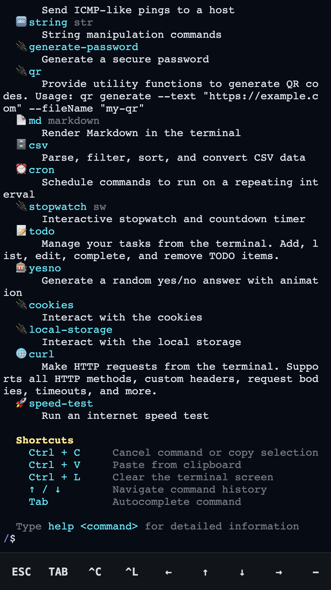
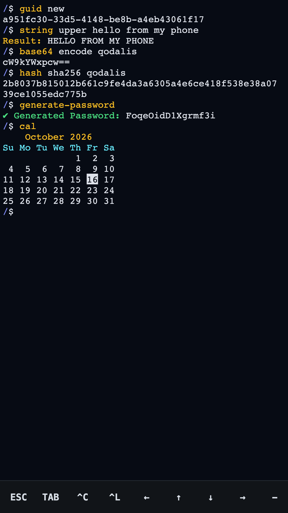
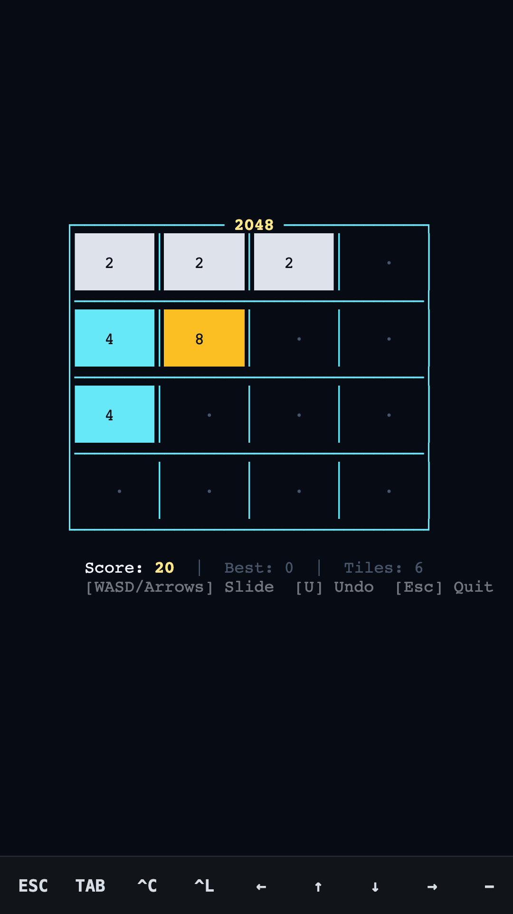
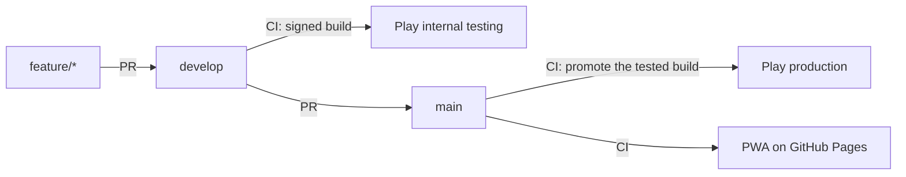

# Qodalis CLI for phones

The Qodalis CLI terminal as an installable PWA and an Android app: commands, a file system, an editor and games
that run offline, with no account and no data collection.

[Google Play](https://play.google.com/store/apps/details?id=com.qodalis.cli) ·
[Open in the browser](https://qodalis-solutions.github.io/pwa-cli/) ·
[Docs](https://cli.qodalis.com/docs) ·
[Privacy](https://cli.qodalis.com/privacy/)

&nbsp;
&nbsp;

## What it is

A thin mobile shell around the [Qodalis CLI](https://cli.qodalis.com) engine. It consumes the published `@qodalis/*`
npm packages, not a local web-cli build, so engine fixes reach the app after a web-cli npm release and a dependency
bump here.

| Repository | Role |
| --- | --- |
| [web-cli](https://github.com/qodalis-solutions/web-cli) | The terminal engine, its Angular/React/Vue wrappers and the plugins bundled here |
| [cli-server-node](https://github.com/qodalis-solutions/cli-server-node), [cli-server-dotnet](https://github.com/qodalis-solutions/cli-server-dotnet), [cli-server-python](https://github.com/qodalis-solutions/cli-server-python) | Optional servers for remote commands; this app does not need one |
| [cli-server-dashboard](https://github.com/qodalis-solutions/cli-server-dashboard) | Admin dashboard for the servers |
| [mcp-cli](https://github.com/qodalis-solutions/mcp-cli) | Connects Claude Code to a server |
| **pwa-cli** | This repository |

## Platforms

One Angular codebase, wrapped per platform with [Capacitor](https://capacitorjs.com).

| Platform | Status | Ships through | Code |
| --- | --- | --- | --- |
| Web (PWA) | Live | GitHub Pages, installable from the browser | `src/` |
| Android | Live | Google Play (`com.qodalis.cli`, target SDK 36) | `android/` |
| iOS | Planned | App Store / TestFlight | `ios/` |
| Desktop | Planned | Electron | `electron/` |

Platform code stays in its own folder, npm scripts are prefixed by platform (`android:*`, later `ios:*` and
`electron:*`), and each platform gets its own tester and production jobs in CI. Per-platform behaviour in the app goes
through [`src/app/native/native-shell.ts`](src/app/native/native-shell.ts).

## What is inside

The CLI engine with every plugin that runs on the device; none needs a server. The list is in
[`src/app/cli-modules.ts`](src/app/cli-modules.ts).

| Area | Commands |
| --- | --- |
| Developer tools | `guid`, `hash`, `base64`, `jwt`, `regex`, `json`, `csv`, `cron`, string tools, password generator |
| File system | `ls`, `cd`, `cat`, `grep`, `sed`, `awk`, `find`, `tree`, pipes, aliases and the `nano` editor; files persist on the device |
| Network | `curl`, `wget`, `speed-test`: the only commands that go online, and only to the URLs you give |
| Productivity | To-do list, stopwatch, QR codes, Markdown, charts |
| Games | 2048, Tetris, Snake, Minesweeper, Sudoku, Wordle; play by touch (pads, swipes, taps) or keyboard |
| Languages | English plus 10 translations; starts in the device language when one matches |

The users plugin is left out on purpose: its first-run wizard would ask for an email and password before the terminal
can be used.

## Made for touch screens

| Feature | Details |
| --- | --- |
| Extra keys | Two rows: Esc, Tab, Ctrl+C, Home, End, Del, arrows and `/ \| -`, sent as real key presses (`src/app/extra-keys/`). CTRL is sticky: tap it, then a key (also on the keyboard: Ctrl+A/E/U/K/W/L); double-tap locks it. Held arrows and Del repeat |
| Game pads | In a game the keys become big game buttons (`src/app/games/game-pads.ts`); swipes on the board send arrows, a tap rotates (Tetris) or reveals (Minesweeper). The on-screen keyboard closes but a hardware keyboard keeps working; Wordle keeps the keyboard |
| Keyboard-aware layout | The terminal stays above the on-screen keyboard (`src/app/viewport.ts`) |
| No autocorrect on Android | `android.captureInput` in `capacitor.config.ts` makes keyboards send plain keys, so commands arrive exactly as typed |
| Edge to edge | Respects notches and the navigation bar; the system bars follow the terminal theme |
| Back button | Closes the keyboard; in a game or prompt presses Escape; otherwise (or pressed twice) backgrounds the app with the session kept |
| Offline | The PWA is cached by a service worker; the Android app ships everything inside |

## Development

Requires Node.js `^22.22.3`, `^24.15.0` or `>=26` (see `engines`).

| Command | What it does |
| --- | --- |
| `npm install` | Install dependencies |
| `npm start` | Dev server on http://localhost:4310 |
| `npm run build` | Production build into `dist/pwa-cli/browser` |
| `npm run serve:dist` | Serve the production build, service worker on, at http://localhost:8080 |
| `npm test` | Playwright against the production build (run `npm run build` first) |

Playwright runs on an emulated Pixel 7 and on desktop Chrome: boot, plugin commands, file persistence, the extra keys,
the layout with the keyboard open, the web manifest, offline use and the privacy page. Install the browser once with
`npx playwright install chromium`.

### Android

Needs JDK 21 (or 17) and the Android SDK. `scripts/gradlew.sh` picks a supported JDK even when a newer one is the
default.

| Command | What it does |
| --- | --- |
| `npm run android:apk` | Build, `cap sync`, debug APK |
| `npm run android:bundle` | Build, `cap sync`, signed release bundle (upload key from the git-ignored `android/keystore.properties`) |
| `npm run android:open` | Open the project in Android Studio |
| `npm run cap:sync` | Build and copy the web app into `android/` |

## Releases

| Event | CI job | Result |
| --- | --- | --- |
| Pull request into `develop` or `main` | `ci.yml` | Build, Playwright tests, Android debug APK |
| Merge into `develop` | `ci.yml` | Build, Playwright tests, signed bundle rolled out to Play internal testers |
| Merge into `main` | `release.yml` | Publishes the PWA and promotes the exact build testers had to production; nothing is rebuilt |

To release:

1. Bump `version` in `package.json`.
2. Add release notes in `fastlane/metadata/android/en-US/changelogs/<derived>.txt` (`1.2.3` becomes `10203.txt`). CI
   picks the next free versionCode from Play, so several builds of one version can reach testers.
3. Merge into `develop`, test the internal build, then merge `develop` into `main`. The repository variable
   `PLAY_PRODUCTION_ROLLOUT` (for example `0.2`) stages the production rollout.

Secrets, Play Console answers, testers and API notes are in [PLAY_STORE.md](PLAY_STORE.md).

Google Play from the command line with [fastlane](https://fastlane.tools) (`bundle install` once):

| Command | What it does |
| --- | --- |
| `bundle exec fastlane status` | Versions on each track and the next versionCode |
| `bundle exec fastlane internal` | Build the signed bundle and upload it to internal testing |
| `bundle exec fastlane rollout` | Roll out a draft release on a track to its testers |
| `bundle exec fastlane production` | Promote the internal build of `package.json`'s version (`rollout:0.2` for a staged rollout) |
| `bundle exec fastlane listing images_only:true` | Upload icon, feature graphic and screenshots (drop `images_only` to include the text) |

`npm run play:status`, `play:internal`, `play:promote` and `play:listing` call the matching lanes.

## Store assets

| Command | What it does |
| --- | --- |
| `npm run assets` | Every icon and splash screen from the SVGs in `resources/` |
| `npm run screenshots` | Play screenshots and feature graphic into `fastlane/metadata` (needs a production build) |

Listing text and images live in [`fastlane/metadata/android/en-US`](fastlane/metadata/android/en-US). The privacy
policy is served at https://cli.qodalis.com/privacy/ (source in web-cli, `apps/docs/src/static/privacy`);
[`public/privacy.html`](public/privacy.html) is the copy shipped with the app and shown by the `privacy` command. Keep
the two in sync.

## Built with

[Angular 22](https://angular.dev), [`@qodalis/angular-cli`](https://www.npmjs.com/package/@qodalis/angular-cli),
[xterm.js](https://xtermjs.org), [Capacitor 8](https://capacitorjs.com), [Playwright](https://playwright.dev) and
[fastlane](https://fastlane.tools).
