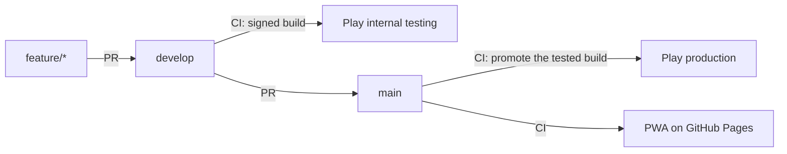

<div align="center">


# Qodalis CLI for phones

**A real terminal in your pocket.** 100+ commands, a file system, an editor and terminal games.
Works offline, needs no account, collects no data.

[](https://github.com/qodalis-solutions/pwa-cli/actions/workflows/ci.yml)
[](https://github.com/qodalis-solutions/pwa-cli/actions/workflows/release.yml)


[**Google Play**](https://play.google.com/store/apps/details?id=com.qodalis.cli) ·
[**Open in the browser**](https://qodalis-solutions.github.io/pwa-cli/) ·
[Qodalis CLI docs](https://cli.qodalis.com) ·
[Privacy](https://cli.qodalis.com/privacy/)

&nbsp;
&nbsp;


</div>

## Platforms

One Angular codebase, wrapped per platform with [Capacitor](https://capacitorjs.com).

| Platform | Status | Ships through | Code |
| --- | --- | --- | --- |
| 🌐 Web (PWA) | ✅ Live | GitHub Pages, installable from the browser | `src/` |
| 🤖 Android | ✅ Live | Google Play (`com.qodalis.cli`) | `android/` |
| 🍎 iOS | 🗓 Planned | App Store / TestFlight | `ios/` (via `npx cap add ios`) |
| 🖥 Desktop | 🗓 Planned | Electron | `electron/` |

Platform code stays in its own folder, npm scripts are prefixed by platform (`android:*`, later
`ios:*`, `electron:*`), and each platform gets its own tester and production jobs in CI. Per-platform
behaviour in the app goes through [`src/app/native/native-shell.ts`](src/app/native/native-shell.ts).

## What's inside

The [Qodalis CLI](https://cli.qodalis.com) engine with every plugin that runs on the device. None
needs a server.

| | |
| --- | --- |
| 🛠 **Developer tools** | `guid`, `hash`, `base64`, `jwt`, `regex`, `json`, `csv`, `cron`, string tools, password generator |
| 📁 **File system** | `ls`, `cd`, `cat`, `grep`, `sed`, `awk`, `find`, `tree`, pipes, aliases, the `nano` editor; files persist on the device |
| 🌐 **Network** | `curl`, `wget`, `speed-test` (the only commands that go online, and only to the URLs you give) |
| ✅ **Productivity** | to-do list, stopwatch, QR codes, Markdown, charts |
| 🎮 **Games** | 2048, Tetris, Snake, Minesweeper, Sudoku, Wordle |
| 🌍 **Languages** | English plus 10 translations |

The bundled plugins are listed in [`src/app/cli-modules.ts`](src/app/cli-modules.ts).

## Made for touch screens

- ⌨️ **Extra keys row**: Esc, Tab, Ctrl+C, Ctrl+L, arrows and `- / | ~`, sent as real key presses so
  shortcuts and games work.
- 📐 **Keyboard-aware layout**: the terminal stays above the on-screen keyboard.
- ✍️ **No autocorrect on Android**: keyboards send plain keys, so commands arrive exactly as typed
  and keyboards don't learn what you type.
- 📱 **Edge to edge**: respects notches and the navigation bar; the system bars follow the terminal
  theme.
- ↩️ **Back button** closes the keyboard, then backgrounds the app with the session kept.
- 📴 **Offline**: the PWA is cached by a service worker; the Android app ships everything inside.

## Quick start

Requires Node 22.22+ or 24.15+.

```bash
npm install
npm start               # dev server on http://localhost:4310
npm run build           # production build in dist/pwa-cli/browser
npm run serve:dist      # serve the production build (service worker on) on :8080
```

### Tests

Playwright runs the production build on an emulated Pixel 7 and on desktop Chrome: boot, plugin
commands, file persistence, the extra keys, the layout with the keyboard open, the web manifest,
offline use and the privacy page.

```bash
npm run build
npx playwright install chromium   # once
npm test
```

### Android

Needs JDK 21 (or 17) and the Android SDK. `scripts/gradlew.sh` picks the right JDK even when a newer
one is the default.

```bash
npm run android:apk       # debug APK
npm run android:bundle    # signed release bundle (upload key from android/keystore.properties)
npm run android:open      # open in Android Studio
```

## Releases



- **Merge into `develop`**: CI tests, builds a signed bundle and rolls it out to internal testers.
- **Merge into `main`**: CI publishes the PWA and promotes the exact build testers had to production.
  Nothing is rebuilt.
- iOS and desktop will follow the same flow: `develop` to TestFlight or a beta channel, `main` to the
  stores.

To release, bump `version` in `package.json` and add release notes in
`fastlane/metadata/android/en-US/changelogs/<versionCode>.txt` (1.2.3 → `10203.txt`). The whole flow,
secrets and Play Console answers are in [PLAY_STORE.md](PLAY_STORE.md).

Google Play from the command line, with [fastlane](https://fastlane.tools):

```bash
fastlane status                   # what's on each track, and the next versionCode
fastlane rollout                  # roll out an internal draft to testers
fastlane production               # promote the tested build of this version
fastlane listing images_only:true # upload icon, feature graphic and screenshots
```

## Store assets

```bash
npm run assets        # every icon and splash from the SVGs in resources/
npm run screenshots   # Play screenshots and feature graphic (needs a production build)
```

The icon lives in [`resources/icon.svg`](resources/icon.svg). Listing text and images are in
[`fastlane/metadata/android/en-US`](fastlane/metadata/android/en-US). The privacy policy is served at
https://cli.qodalis.com/privacy/ (source in web-cli, `apps/docs/src/static/privacy`).
[`public/privacy.html`](public/privacy.html) is the copy shipped with the PWA, and the `privacy`
command shows it in the app. Keep the two in sync.

## Built with

[Angular 22](https://angular.dev) ·
[`@qodalis/angular-cli`](https://www.npmjs.com/package/@qodalis/angular-cli) ·
[xterm.js](https://xtermjs.org) ·
[Capacitor 8](https://capacitorjs.com) (Android target SDK 36) ·
[Playwright](https://playwright.dev) ·
[fastlane](https://fastlane.tools)
